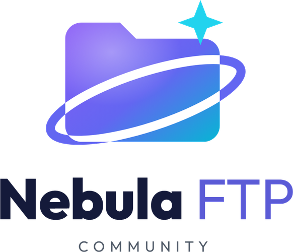

<div align="center">



### **Turn Telegram into Your Unlimited Storage via SFTP and Web**

[](LICENSE)
[](https://www.python.org)
[](https://docker.com)
[](tests)
[](https://github.com/samucamg/NebulaFTP/pulls)

[🇧🇷 Português](README.md) | [🇺🇸 English](#)

**SFTP server** with a **web panel** (file manager + player), using **Telegram as the storage backend**.

</div>

---

## 📌 What is Nebula FTP?

**Nebula FTP** turns any Telegram channel into a "drive" accessible over **SFTP** and from the **browser**.
You keep using your usual clients (FileZilla, WinSCP, RaiDrive, rclone...) and the system
takes care of **splitting, uploading and indexing** every file on Telegram.

> 🆕 **Version 2 (Community):** rewritten from scratch, with a single core, automated tests and a focus on
> **SFTP + Web**. The FTP protocol was removed: SFTP is safer (encrypted), passes firewalls/NAT
> with a single port and is supported by the same clients.

### ✨ Features

- **🔐 SFTP Server (SSH)** — port `2222` (default): list, upload, download, rename, move, delete
  and create folders. Works with **FileZilla, WinSCP, RaiDrive and rclone**. Host key generated automatically.
- **🖥️ Web Panel** — port `8082` (default):
  - 📂 File manager: upload (including multi-GB files), download, rename, delete, create folders;
  - 🎬 In-browser video and audio **player** (mp4, webm, mp3, m4a, ogg, opus, wav), with seeking;
  - 👥 User management (admin only).
- **👥 Isolated multi-user** — each user has **their own folder** and sees only it. Only the **admin** sees the root.
- **⚡ Turbo Upload (Staging)** — uploads land on **local disk first (instant)** and go to
  Telegram in the **background**, with no client timeouts. Pending uploads **resume after a restart**.
- **☁️ On-demand reading** — files are reassembled from their parts on Telegram, even with no local copy.
  Only the requested ranges are downloaded (Range/seek), so you can **watch media without downloading the whole file**.
- **♻️ No leftovers in the channel** — overwriting or deleting a file also removes its old parts from Telegram.
- **🗄️ SQLite** — a single file, nothing to install. *(Optional MongoDB: 🚧 planned)*
- **🛡️ Robust and secure** — **scrypt** password hashes, **CSRF** protection, lockout after 5 wrong passwords,
  retry with backoff (FloodWait), clock check at startup, logs without secrets.
- **🧪 Tested** — 79 automated tests with a simulated Telegram, checking the round-trip **sha256**.

> 💾 **Unlimited space:** Telegram imposes no storage limit. In Community the real limit is
> **speed**: a single bot uploads one part at a time (up to ~10 MB/s).

> 💎 **Community vs Pro:** this is the **Community (open source)** version — 1 bot.
> The **Pro** version brings Multi-Bot (4–8 bots, up to 60 MB/s), automatic backup channel and priority support.
> See the full table in [ECOSYSTEM-en.md](docs/ECOSYSTEM-en.md).

---

## 🏗️ Architecture

```
┌──────────────────────────────┐          ┌──────────────────────────┐
│  SFTP client (FileZilla,     │          │  Browser                 │
│  WinSCP, RaiDrive, rclone)   │          │  (web panel :8082)       │
└──────────────┬───────────────┘          └────────────┬─────────────┘
               │ :2222                                 │
               └──────────────────┬────────────────────┘
                                  ▼
              ┌───────────────────────────────────────┐
              │          NEBULA FTP (core)            │
              │  ┌─────────────────────────────────┐  │
              │  │ NebulaVFS: folders, users,      │  │
              │  │ permissions, versions, locks    │  │
              │  │ Local staging (turbo upload)    │  │
              │  │ Upload Worker (1 bot)           │  │
              │  │ Part cache + cleanup (GC)       │  │
              │  └─────────────────────────────────┘  │
              └──────┬─────────────────────┬──────────┘
                     ▼                     ▼
         ┌──────────────────┐   ┌──────────────────────┐
         │ SQLite           │   │      Telegram        │
         │ (metadata)       │   │ (channel: parts      │
         │                  │   │  name.part001...)    │
         └──────────────────┘   └──────────────────────┘
```

**Upload flow:** client uploads → file written to `data/staging` (instant) →
the worker splits it into parts (`CHUNK_SIZE_MB`) and sends them to the channel → parts are recorded in the database →
the local copy is removed.

**Download flow:** the server reads the part map and **downloads from Telegram only the requested range**,
keeping it in a temporary local cache.

---

## 📁 Requirements

- 🐍 **Python 3.10+** (Windows or Linux) or 🐳 **Docker** (Linux/VPS recommended).
- 📱 **Telegram**: API ID/Hash ([my.telegram.org](https://my.telegram.org)), a **bot** ([@BotFather](https://t.me/BotFather)) and a **channel** with the bot as administrator.
  [📖 Full Telegram guide →](docs/TELEGRAM_SETUP-en.md)
- 💽 Disk space for staging and cache (at least the size of the largest file you will upload).
- 🕒 **Correct server clock** — Telegram rejects connections more than 30 s off (the program warns at startup).

---

## 🚀 Installation

### Option 1 — Docker (recommended for Linux/VPS) 🐳

```bash
# 1) Clone the repository
git clone https://github.com/samucamg/NebulaFTP.git
cd NebulaFTP

# 2) Configure .env (API_ID, API_HASH, BOT_TOKENS, CHAT_ID, WEB_ADMIN_PASSWORD...)
cp .env.example .env
nano .env

# 3) Start
docker compose up -d --build

# 4) Follow logs
docker compose logs -f nebulaftp
```

> Everything that must persist (database, staging, cache, SFTP key and bot session) lives in `./data`.

### Option 2 — Python directly 🐍

```bash
# 1) Clone and set up environment
git clone https://github.com/samucamg/NebulaFTP.git
cd NebulaFTP
python3 -m venv .venv
source .venv/bin/activate        # Windows: .venv\Scripts\activate

# 2) Install dependencies
pip install -r requirements.txt

# 3) Configure
cp .env.example .env             # Windows: copy .env.example .env
nano .env

# 4) Run
python main.py
```

### 🐧 Running as a service (systemd)

```ini
# /etc/systemd/system/nebulaftp.service
[Unit]
Description=NebulaFTP Community
After=network-online.target

[Service]
WorkingDirectory=/opt/NebulaFTP
ExecStart=/opt/NebulaFTP/.venv/bin/python main.py
Restart=on-failure

[Install]
WantedBy=multi-user.target
```

```bash
sudo systemctl daemon-reload && sudo systemctl enable --now nebulaftp
journalctl -u nebulaftp -f
```

---

## 🔐 First Access and Users

- The **admin** user is created on first run with login `WEB_ADMIN_USER` (default `admin`)
  and the password `WEB_ADMIN_PASSWORD` from `.env` (**required**, there is no default password).
- Open the **web panel** at `http://SERVER_IP:8082` and log in as admin.
- Under **Users**: create, change password or delete. Each user gets the folder `/<login>`
  and, when connected, **sees only it** as the root.
- The same login and password work for **SFTP** (port `2222`).
- ⛔ After 5 wrong passwords, the login is locked for 60 seconds.

---

## ⚙️ Configuration (.env)

| Variable | Default | Description |
|---|---|---|
| `API_ID` / `API_HASH` | — | Credentials from [my.telegram.org](https://my.telegram.org) |
| `BOT_TOKENS` | — | Bot token *(Community uses 1 bot; Multi-Bot = Pro 💎)* |
| `CHAT_ID` | — | ID of the channel where files are stored (format `-100...`) |
| `WEB_ADMIN_USER` | `admin` | Administrator login |
| `WEB_ADMIN_PASSWORD` | — | Administrator password (required on first run) |
| `HOST` | `0.0.0.0` | Listen interface |
| `SFTP_PORT` | `2222` | **SFTP** port |
| `WEB_PORT` | `8082` | **Web panel** port |
| `DATA_DIR` | `data` | Staging, cache and bot session |
| `DB_FILE` | `nebula.db` | SQLite database file |
| `SFTP_HOST_KEY` | `sftp_host_key` | SFTP host key (created automatically) |
| `CHUNK_SIZE_MB` | `100` | Size of each part sent to Telegram |
| `MAX_STAGING_AGE` | `3600` | Seconds before orphan staging files are cleaned |
| `CACHE_MAX_AGE` | `3600` | Seconds before unused cached parts are cleaned |
| `LOG_LEVEL` | `INFO` | `DEBUG`, `INFO`, `WARNING`, `ERROR` |

Full commented template: [`.env.example`](.env.example).

---

## 📁 Mounting as a Network Drive (RaiDrive and rclone)

Nebula FTP is a standard SFTP server — it can be mounted as a **network drive**:

| Goal | Tool |
|---|---|
| Windows — drive letter (Z:, Y:...) | **RaiDrive** (SFTP) |
| Linux — mounted folder or WebDAV for other apps | **rclone** (mount + `serve webdav`) |
| Windows/Linux — command line | **rclone** |

### 🪟 Windows — RaiDrive (recommended)

1. Download and install [RaiDrive](https://www.raidrive.com/).
2. Open RaiDrive → **Add** → group **NAS** → **SFTP**.
3. Fill in:
   - **Address:** `SERVER_IP`
   - **Port:** `2222`
   - **Username / Password:** a user created in the web panel
4. Pick a letter (e.g. `Z:`) → **Connect**.
5. Done: the "drive" shows up in **Windows Explorer** with your Telegram files. ✅

> Also works with **FileZilla** and **WinSCP**: protocol **SFTP**, port `2222`.

### 🐧 Linux — rclone (mount and WebDAV)

```bash
sudo apt update && sudo apt install -y rclone fuse3
```

Edit `~/.config/rclone/rclone.conf`:

```ini
[nebula]
type = sftp
host = SERVER_IP
user = YOUR_USER
pass = PUT_HERE_THE_OUTPUT_OF:  rclone obscure "YOUR_PASSWORD"
port = 2222
```

Test and mount as a folder:

```bash
rclone lsd nebula:                   # test the connection
mkdir -p ~/NebulaFTP
rclone mount nebula: ~/NebulaFTP --vfs-cache-mode writes &
# to unmount: fusermount -u ~/NebulaFTP
```

**Turn it into WebDAV** (Windows "Map network drive", Kodi, Jellyfin...):

```bash
rclone serve webdav nebula: --addr :8090 --user YOUR_USER --pass YOUR_PASSWORD
# WebDAV endpoint: http://SERVER_IP:8090
```

### 🪟 Windows — rclone (alternative)

```powershell
winget install Rclone.Rclone
rclone config                       # same "nebula" remote (type = sftp, port 2222)
rclone mount nebula: N: --vfs-cache-mode writes
```

### ⚠️ Mount Notes

- **Uploads**: instant (local staging) and finish in the background on Telegram. ✅
- **Videos**: SFTP reads by range (seek), so you can play without downloading everything.
  The first access to each part depends on Telegram's download speed.
- RaiDrive and rclone cache listings — tune the cache for very large folders.

---

## 🌌 Nebula Ecosystem

| Project | Description | Status |
|---------|-------------|--------|
| **[NebulaFTP](docs/ECOSYSTEM-en.md#-nebulaftp)** | SFTP server + web panel with Telegram (**this repository**) | ✅ **Available** |
| **[NebulaStream](docs/ECOSYSTEM-en.md#-nebulastreaming)** | Web interface + streaming player | 🚧 In development |
| **[NebulaWebDAV](docs/ECOSYSTEM-en.md#%EF%B8%8F-nebulawebdav)** | WebDAV server for Kodi/Plex | 🚧 In development |
| **[NebulaSFTP](docs/ECOSYSTEM-en.md#-nebulasftp)** | Dedicated high-performance SFTP product | 📋 Planned |

> 💎 **Multi-Bot, backup channel and speeds up to 60 MB/s are exclusive to the Pro version.**
> [Learn more about the Ecosystem →](docs/ECOSYSTEM-en.md)

---

## 🔒 Security

- 🔑 **scrypt** password hashes; forms protected against **CSRF**.
- 🌐 The web panel uses HTTP. On the internet, put it behind an **HTTPS** proxy (Caddy, Nginx).
- 💾 **Back up the database** (`DB_FILE`): without it, files cannot be reassembled from the channel.
- ☁️ Community has no backup channel: keep copies of anything important.

---

## ❓ Troubleshooting (quick)

| Problem | Likely cause / fix |
|---|---|
| `Connection refused` | Server stopped, wrong port or firewall. Open `2222` and `8082`. |
| Clock error / `msg_id too low` at startup | Wrong server clock. Enable NTP (`timedatectl set-ntp true`). |
| `Peer id invalid` in logs | The bot is not a channel admin — add it as administrator. |
| Forgot the admin password | Set a **new** `WEB_ADMIN_USER` with `WEB_ADMIN_PASSWORD` in `.env` and restart: a new admin is created. Log in with it and reset the old one's password in the panel. |
| Generic upload error in the client | Check `nebula.log`: unexpected SFTP errors are logged with details. |
| Recreated container lost files | `./data` was not in a volume — see the Docker section. |

---

## 🧪 Tests

```bash
pip install -r requirements-dev.txt
pytest -q
```

The suite uses a simulated Telegram and compares the round-trip **sha256** through the core, SFTP and web.

---

## 🤝 Contributing

Contributions are welcome! Open an [issue](https://github.com/samucamg/NebulaFTP/issues) or a
[pull request](https://github.com/samucamg/NebulaFTP/pulls) — and ⭐ star the project!

---

## 📜 License

This project is licensed under the **MIT** license. See [LICENSE](LICENSE) for details.

---

## 💬 Support

- 🐛 **Bugs and suggestions:** [GitHub Issues](https://github.com/samucamg/NebulaFTP/issues)
- 💡 **Discussions:** [GitHub Discussions](https://github.com/samucamg/NebulaFTP/discussions)
- 💎 **Pro version / business inquiries:** samuel@inglescurso.com.br *(business only — no free support by e-mail)*

---

## 📊 Stats


---

<div align="center">

**Made with ❤️ by [Samuel de Sousa Santos](https://github.com/samucamg)**

</div>
