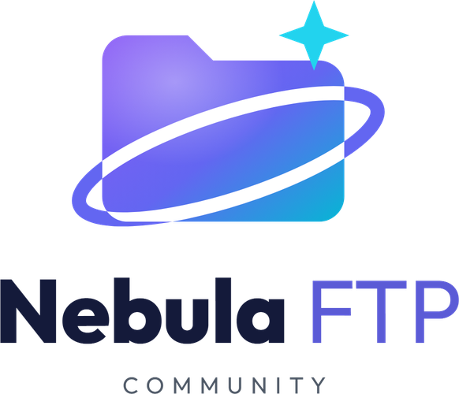
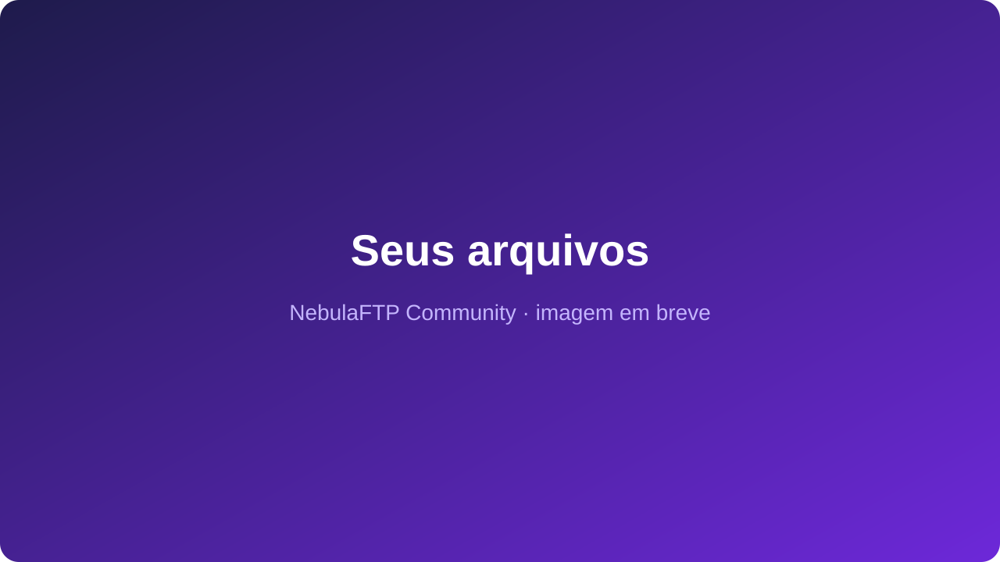
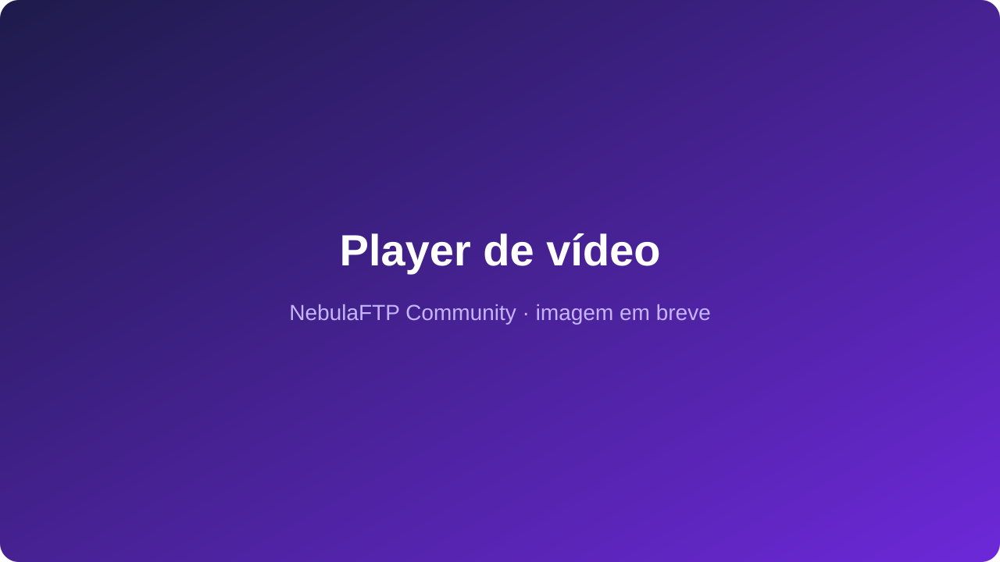
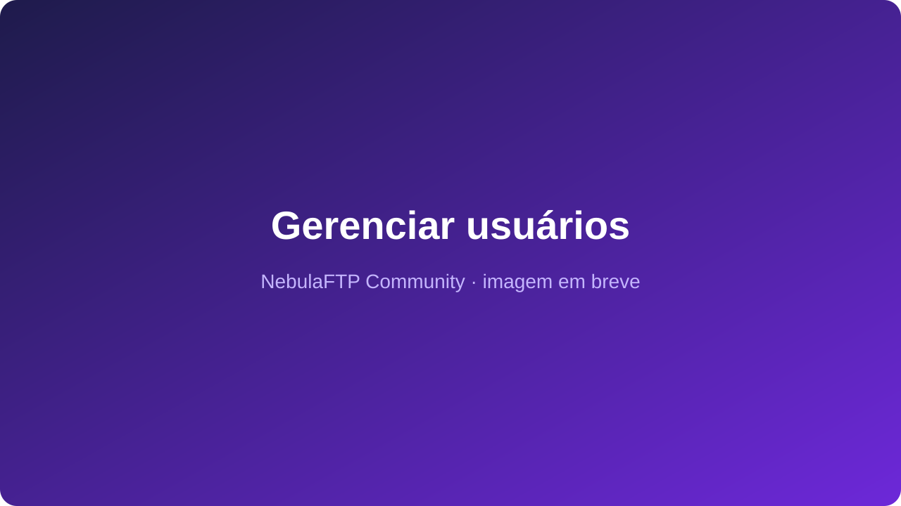
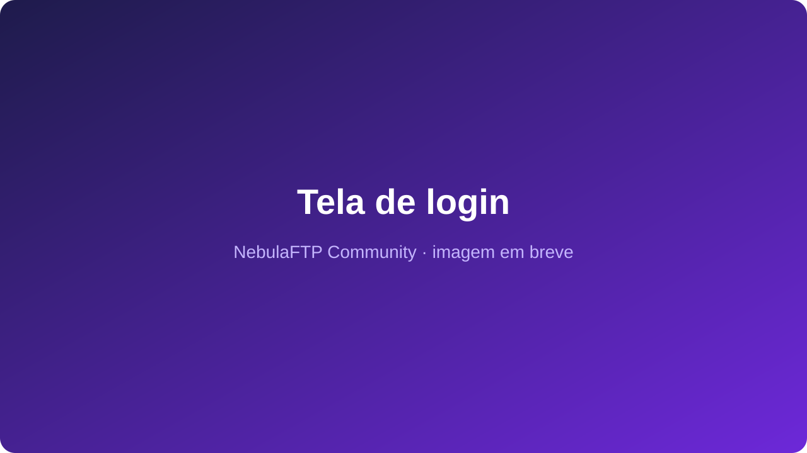
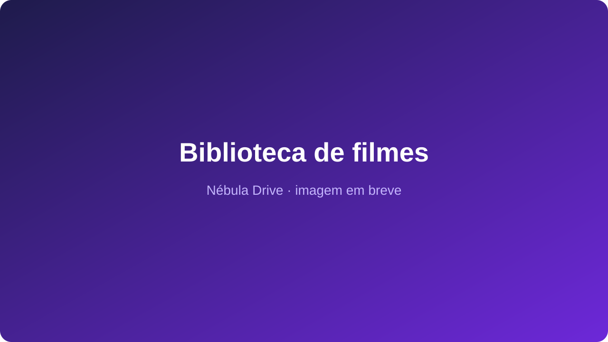
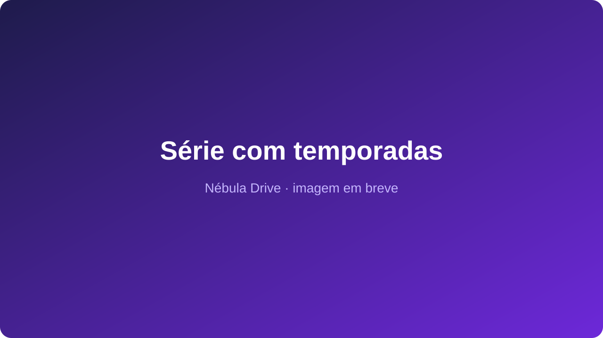
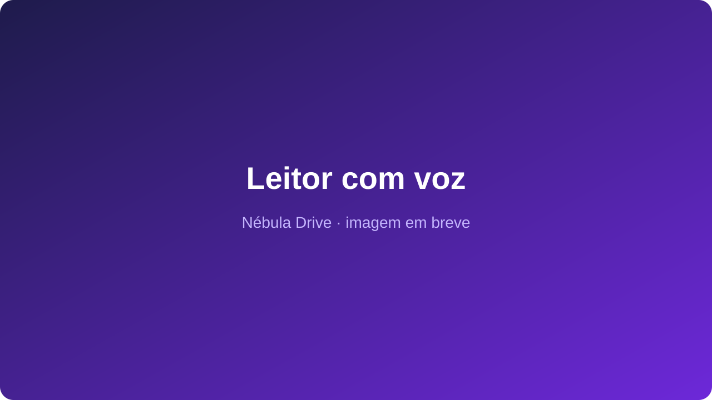
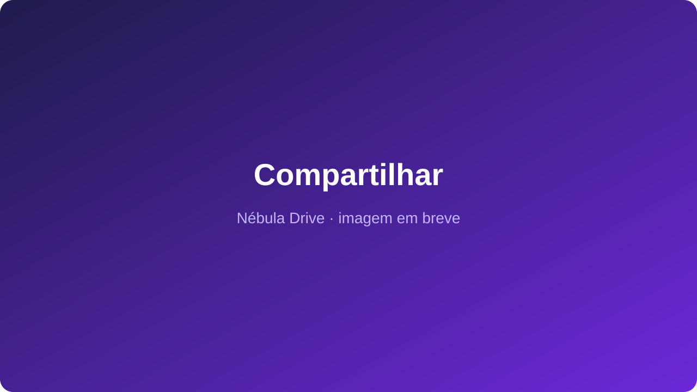

<div align="center">



### **Espaço ilimitado para os seus arquivos, usando o Telegram**

[](LICENSE)
[](#)
[](https://docker.com)
[](#)

[🇧🇷 Português](#) | [🇺🇸 English](README-en.md)

**Guarde quantos arquivos quiser, sem pagar por espaço.** Acesse pelo navegador ou como um disco no seu computador.

</div>

---

## 💡 O que você ganha

- ☁️ **Espaço ilimitado** — seus arquivos ficam guardados em um canal privado do Telegram. Sem mensalidade de armazenamento.
- 💽 **Funciona como um disco no seu PC** — aparece no Windows como uma unidade (`Z:`), sem ocupar o seu HD.
- 🌐 **Acesse de qualquer lugar** — entre pelo navegador para enviar, baixar, renomear e organizar.
- 🎬 **Assista e ouça na hora** — vídeos e músicas tocam direto no navegador, sem baixar o arquivo inteiro.
- 👨‍👩‍👧 **Vários usuários** — cada pessoa tem a própria pasta e só vê o que é dela.
- 🛠️ **Você no comando** — crie, edite e remova usuários pelo painel.
- 🔒 **Seguro** — conexão criptografada e senhas protegidas.
- 🆓 **Grátis e de código aberto** — instale em poucos minutos no seu computador ou servidor.

> ℹ️ Esta edição gratuita usa **um robô do Telegram**, então o espaço é ilimitado, mas a velocidade
> de envio tem um teto (cerca de 10 MB/s). Precisa de mais? Veja o [**Nébula Drive**](#-quer-mais-conheça-o-nébula-drive).

---

## 📸 Como é

<table>
<tr>
<td></td>
<td></td>
</tr>
<tr>
<td align="center"><b>Seus arquivos</b> no navegador</td>
<td align="center"><b>Assista</b> sem baixar</td>
</tr>
<tr>
<td></td>
<td></td>
</tr>
<tr>
<td align="center"><b>Gerencie</b> os usuários</td>
<td align="center"><b>Cada um</b> com seu acesso</td>
</tr>
</table>

---

## 🚀 Instale em 3 passos

Você vai precisar de uma conta no Telegram. O [📖 guia do Telegram](docs/TELEGRAM_SETUP.md) mostra como criar o robô e o canal, passo a passo.

```bash
# 1) Baixe
git clone https://github.com/samucamg/NebulaFTP.git && cd NebulaFTP

# 2) Preencha os dados do Telegram e a senha do administrador
cp .env.example .env && nano .env

# 3) Ligue
docker compose up -d --build
```

Pronto! Abra `http://IP_DO_SERVIDOR:8082` no navegador e entre como administrador.

📖 **Instalação sem Docker, Windows, usar como disco `Z:` (RaiDrive) e todas as opções:** [Guia de instalação](docs/INSTALACAO.md)

---

## 💎 Quer mais? Conheça o Nébula Drive

<div align="center">

</div>

O **Nébula Drive** é a edição completa: junta em um só lugar a sua **nuvem pessoal** (como o Google Drive),
o seu **streaming de filmes e séries** (como a Netflix), um **leitor de livros que lê em voz alta**,
um **player de músicas** e um **Office online** para criar e editar documentos.

| | 🆓 Community | 💎 Nébula Drive |
|---|:---:|:---:|
| Espaço ilimitado no Telegram | ✅ | ✅ |
| Acesso como disco no computador | ✅ | ✅ PC, Mac, celular e TV |
| Vários usuários, cada um com sua pasta | ✅ | ✅ + grupos, cotas e prazo de acesso |
| Assistir vídeos e ouvir músicas no navegador | ✅ básico | ✅ estilo Netflix |
| Velocidade de envio | 1 robô | ⚡ vários robôs, muito mais rápido |
| Compartilhar como no Google Drive (links com senha e validade) | ❌ | ✅ |
| Bibliotecas com capas, sinopses e temporadas | ❌ | ✅ |
| "Continuar assistindo" e "Continuar lendo" | ❌ | ✅ |
| Mini novelas, músicas e vídeo aulas organizadas | ❌ | ✅ |
| Leitor de livros e quadrinhos com voz natural | ❌ | ✅ |
| Criar e editar Word, Excel e PowerPoint online | ❌ | ✅ |
| Importar pastas do Google Drive | ❌ | ✅ |
| Histórico de versões, lixeira e favoritos | ❌ | ✅ |
| Assistente de Inteligência Artificial | ❌ | ✅ |
| Assistir na Smart TV (Jellyfin, Kodi) | ❌ | ✅ |
| Cópia de segurança automática dos arquivos | ❌ | ✅ |
| App para celular e computador, tema escuro | ❌ | ✅ |
| Banco MongoDB (para instalações grandes) | ❌ | ✅ |
| Suporte | Comunidade | Prioritário |

<table>
<tr>
<td></td>
<td></td>
<td></td>
</tr>
<tr>
<td align="center">🎬 Séries por temporada</td>
<td align="center">📚 Livros que leem para você</td>
<td align="center">🔗 Compartilhe com quem quiser</td>
</tr>
</table>

👉 **[Veja tudo o que o Nébula Drive faz, com fotos de cada tela](docs/NEBULA-DRIVE.md)**

📩 **Quer o Nébula Drive?** Fale comigo: samuel@inglescurso.com.br

---

## ❓ Perguntas rápidas

**É de graça mesmo?** Sim. O NebulaFTP Community é grátis e de código aberto (licença MIT).

**O espaço é ilimitado de verdade?** O Telegram não cobra nem limita o espaço. O limite desta edição é a velocidade de envio.

**Meus arquivos ficam públicos?** Não. Eles ficam em um canal **privado**, que só o seu robô acessa.

**Preciso deixar o computador ligado?** O sistema precisa ficar ligado para você acessar os arquivos. O ideal é instalar em um servidor (VPS).

**Posso perder meus arquivos?** Guarde uma cópia do arquivo do banco de dados: é ele que sabe onde cada arquivo está. O Nébula Drive faz cópias de segurança automáticas.

---

## 🤝 Contribuindo

Contribuições são bem-vindas! Abra uma [issue](https://github.com/samucamg/NebulaFTP/issues) ou um
[pull request](https://github.com/samucamg/NebulaFTP/pulls) — e ⭐ dê uma estrela no projeto!

---

## 📜 Licença

Este projeto está sob a licença **MIT**. Veja [LICENSE](LICENSE) para detalhes.

---

## 💬 Suporte

- 🐛 **Bugs e sugestões:** [GitHub Issues](https://github.com/samucamg/NebulaFTP/issues)
- 💡 **Discussões:** [GitHub Discussions](https://github.com/samucamg/NebulaFTP/discussions)
- 💎 **Nébula Drive / assuntos comerciais:** samuel@inglescurso.com.br *(apenas comercial — sem suporte gratuito por e-mail)*

---

## 📊 Estatísticas


---

<div align="center">

**Feito com ❤️ por [Samuel de Sousa Santos](https://github.com/samucamg)**

</div>
