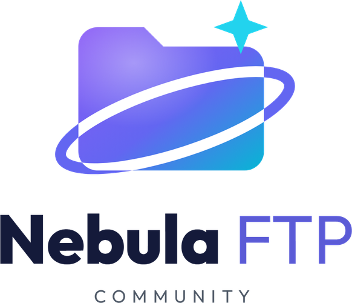

<div align="center">



</div>

---

# 🚀 Guia de Instalação: NebulaFTP Community (Docker)

Bem-vindo ao **NebulaFTP Community Edition**! Este guia vai te ensinar como transformar seu servidor Ubuntu 22.04 em um servidor FTP integrado ao Telegram.

---

## 📋 Pré-requisitos

1. **API ID e API HASH**: Obtenha em [my.telegram.org](https://my.telegram.org)
2. **BOT TOKEN**: Crie um bot com [@BotFather](https://t.me/BotFather)
3. **CHAT ID**: Crie um Canal Privado, adicione o Bot como Admin e pegue o ID no [@userinfobot](https://t.me/userinfobot)

📖 **Guia completo:** [Como configurar o Telegram](TELEGRAM_SETUP.md)

---

## 🛠️ Passo 1: Preparando o Servidor (Ubuntu 22.04)

### 1. Instalar Docker + Docker Compose

```
# Download do instalador oficial do Docker
curl -fsSL https://get.docker.com -o get-docker.sh
```
# Executar instalador
```
sudo sh get-docker.sh
```
# Remover arquivo de instalação
```
rm get-docker.sh
```

### 2. Iniciar Docker

```bash
# Habilitar e iniciar o serviço
sudo systemctl enable --now docker

# Verificar se está rodando
sudo systemctl status docker
```

### 3. Adicionar seu usuário ao grupo Docker (opcional)

```bash
# Permite rodar docker sem sudo
sudo usermod -aG docker $USER

# Aplicar mudanças (ou faça logout/login)
newgrp docker
```

---

## 📂 Passo 2: Clonar o Repositório

```bash
cd /opt/
# Clonar o projeto do GitHub
git clone https://github.com/samucamg/NebulaFTP.git

# Entrar na pasta
cd NebulaFTP
```

---

## ⚙️ Passo 3: Criar Arquivo Docker Compose

### 1. Criar o arquivo

```bash
nano docker-compose.yml
```

### 2. Copiar e colar o conteúdo abaixo

```yaml
version: '3.8'

services:
  app:
    build: .                           # Build local do Dockerfile
    container_name: nebulaftp
    restart: unless-stopped
    ports:
      - "2121:2121"                    # Porta FTP
      - "60000-60100:60000-60100"      # Portas Passivas
    environment:
      - MONGODB=mongodb://mongo:27017
      - HOST=0.0.0.0
    env_file:
      - .env
    volumes:
      - ./staging:/app/staging         # Cache de uploads
      - ./logs:/app/logs               # Logs persistentes
    depends_on:
      - mongo

  mongo:
    image: mongo:6.0
    container_name: nebula_mongo
    restart: unless-stopped
    volumes:
      - mongo_data:/data/db            # Persistência do banco
    environment:
      - MONGO_INITDB_DATABASE=ftp

volumes:
  mongo_data:                          # Volume nomeado
```

**Salvar:** Pressione `Ctrl+O`, depois `Enter`, depois `Ctrl+X`

---

## 🔐 Passo 4: Configurar Credenciais (.env)

### 1. Copiar o exemplo

```bash
cp .env.example .env
```

### 2. Editar com seus dados

```bash
nano .env
```

### 3. Preencher as credenciais

```env
# ========================================
# NEBULA FTP - COMMUNITY EDITION
# ========================================

# ============= TELEGRAM =============
# Obtenha em: https://my.telegram.org
API_ID=12345678
API_HASH=SEU_API_HASH

# Crie com: @BotFather
BOT_TOKEN=1234567890:AABBccDDeeFFggHHiiJJkkLLmmNN

# ID do canal privado (use @userinfobot)
CHAT_ID=-1001234567890

# ============= MONGODB =============
MONGODB=mongodb://mongo:27017

# ============= SERVIDOR FTP =============
HOST=0.0.0.0
PORT=2121

# ============= PERFORMANCE =============
MAX_WORKERS=4
CHUNK_SIZE_MB=64
MAX_RETRIES=5
MAX_STAGING_AGE=3600

# ============= LOGGING =============
LOG_LEVEL=INFO
```

**Salvar:** Pressione `Ctrl+O`, depois `Enter`, depois `Ctrl+X`

---

## 🏗️ Passo 5: Buildar e Iniciar o Servidor

### 1. Build da imagem Docker

```bash
sudo docker compose build
```

**Aguarde:** Primeira vez pode demorar 3-5 minutos (instalando dependências Python).

### 2. Iniciar os containers

```bash
sudo docker compose up -d
```

### 3. Verificar se está rodando

```bash
sudo docker ps
```

Deve aparecer:
```
CONTAINER ID   IMAGE              STATUS         PORTS
abc123...      nebulaftp-app      Up 10 seconds  0.0.0.0:2121->2121/tcp
def456...      mongo:6.0          Up 11 seconds  27017/tcp
```

---

## 👀 Passo 6: Verificar Logs

```bash
sudo docker compose logs -f app
```

**Deve aparecer algo como:**

```
2025-12-14 15:00:00,000 - INFO - 🤖 Inicializando bot...
2025-12-14 15:00:01,000 - INFO - ✅ Bot conectado!
2025-12-14 15:00:02,000 - INFO - ✅ Canal confirmado: Nebula Storage (ID: -1001234567890)
2025-12-14 15:00:03,000 - INFO - 🚀 Nebula FTP Community Edition v1.0
2025-12-14 15:00:03,000 - INFO -    ⚙️ 4 workers | 64MB chunks
2025-12-14 15:00:03,000 - INFO -    🌐 Servidor rodando na porta 2121
```

**✅ Se aparecer isso, está tudo OK!**

**Pressione `Ctrl+C`** para sair dos logs.

---

## 👥 Passo 7: Criar Usuário FTP

O sistema vem sem usuários por padrão. Você precisa criar pelo menos um:

```bash
# Entrar no container
sudo docker exec -it nebulaftp bash

# Rodar gerenciador de usuários
python accounts_manager.py
```

**Será perguntado:**

```
=== Gerenciador de Usuários FTP ===

1. Criar novo usuário
2. Listar usuários
3. Deletar usuário
4. Alterar senha
5. Sair

Escolha uma opção: 1

Username: samuel
Password: minhasenha123
Confirmar password: minhasenha123
Home path (padrão: /samuel): [Enter]

✅ Usuário 'samuel' criado com sucesso!
```

**Sair do container:**

```bash
exit
```

---

## 📡 Passo 8: Conectar via Cliente FTP

Abra o **FileZilla** (ou outro cliente FTP) e conecte:

| Campo | Valor |
|-------|-------|
| **Host** | IP do seu VPS (ex: `192.168.1.100` ou `meusite.com`) |
| **Porta** | `2121` |
| **Usuário** | `samuel` (o que você criou) |
| **Senha** | `minhasenha123` (a que você definiu) |

**Clique em "Quickconnect"** e pronto! 🎉

---

## 💡 Comandos Úteis

### Parar o servidor

```bash
sudo docker compose down
```

### Reiniciar o servidor

```bash
sudo docker compose restart
```

### Ver logs em tempo real

```bash
sudo docker compose logs -f app
```

### Atualizar o código

```bash
# Parar containers
sudo docker compose down

# Atualizar código do GitHub
git pull

# Rebuildar imagem
sudo docker compose build

# Iniciar novamente
sudo docker compose up -d
```

### Fazer backup do banco de dados

```bash
# Criar backup
sudo docker exec nebula_mongo mongodump --db ftp --out /backup

# Copiar para host
sudo docker cp nebula_mongo:/backup ./backup-$(date +%Y%m%d)

# Compactar (opcional)
tar -czf backup-$(date +%Y%m%d).tar.gz ./backup-$(date +%Y%m%d)
```

### Restaurar backup do banco de dados

```bash
# Descompactar (se compactado)
tar -xzf backup-20251214.tar.gz

# Copiar para container
sudo docker cp ./backup-20251214 nebula_mongo:/backup

# Restaurar
sudo docker exec nebula_mongo mongorestore --db ftp /backup/ftp
```

### Ver espaço usado pelos volumes

```bash
sudo docker system df -v
```

### Limpar cache Docker (cuidado!)

```bash
# Remove imagens não usadas
sudo docker image prune -a

# Remove volumes órfãos
sudo docker volume prune
```

### Remover tudo e recomeçar (CUIDADO!)

```bash
# Remove containers, volumes e dados
sudo docker compose down -v

# Remove imagens
sudo docker rmi nebulaftp-app mongo:6.0

# Remove pasta do projeto
cd ..
rm -rf NebulaFTP
```

---

## 🔥 Configuração do Firewall (Importante!)

Se seu servidor tem firewall ativo (UFW), libere as portas:

```bash
# Porta FTP (controle)
sudo ufw allow 2121/tcp

# Portas passivas (transferência de dados)
sudo ufw allow 60000:60100/tcp

# Recarregar firewall
sudo ufw reload

# Verificar regras
sudo ufw status numbered
```

**Para servidores em Cloud (AWS, DigitalOcean, etc.):**
- Configure o **Security Group** ou **Firewall** do painel de controle
- Libere as mesmas portas: `2121/tcp` e `60000-60100/tcp`

---

## ❓ Problemas Comuns

### 1. "Connection refused" ao conectar no FTP

**Causas:**
- Servidor não está rodando
- Firewall bloqueando portas
- IP errado

**Soluções:**
```bash
# Verificar se está rodando
sudo docker ps

# Ver logs
sudo docker compose logs app

# Testar conexão local
telnet localhost 2121

# Verificar firewall
sudo ufw status
```

---

### 2. "Peer id invalid" nos logs

**Causa:** Bot não foi adicionado como admin no canal.

**Solução:**
1. Abra o canal no Telegram
2. Vá em **Administrators** → **Add Admin**
3. Busque o bot pelo username (ex: `@seu_bot`)
4. Marque **todas as permissões**
5. Salve

---

### 3. Container reiniciando constantemente

```bash
# Ver erro completo
sudo docker compose logs app

# Causas comuns:
# ❌ API_ID ou API_HASH inválidos
# ❌ BOT_TOKEN inválido (copie novamente do @BotFather)
# ❌ CHAT_ID errado (use @userinfobot)
# ❌ Bot não tem permissões no canal
```

---

### 4. "Port 2121 already in use"

**Causa:** Outra aplicação está usando a porta 2121.

**Soluções:**

**Opção A - Mudar porta no .env:**
```env
PORT=21210
```

**Opção B - Mudar no docker-compose.yml:**
```yaml
ports:
  - "21210:2121"  # Externa:Interna
```

**Depois:**
```bash
sudo docker compose down
sudo docker compose up -d
```

---

### 5. Erro "docker: command not found"

**Causa:** Docker não foi instalado corretamente.

**Solução:**
```bash
# Reinstalar Docker
curl -fsSL https://get.docker.com | sudo sh
```

---

### 6. "Permission denied" ao criar usuário

**Causa:** MongoDB não tem permissões de escrita.

**Solução:**
```bash
# Recriar volume do MongoDB
sudo docker compose down -v
sudo docker compose up -d
```

---

### 7. Upload funciona mas download falha

**Causas:**
- Portas passivas bloqueadas no firewall
- Cliente FTP em modo ativo (deve ser passivo)

**Soluções:**
```bash
# Liberar portas passivas
sudo ufw allow 60000:60100/tcp

# No FileZilla: Edit → Settings → Connection → FTP
# Marcar "Passive (recommended)"
```

---

## 📚 Próximos Passos

✅ **Servidor funcionando!** Agora você pode:

### 1. Explorar Recursos

- **Multi-usuários:** Crie usuários diferentes para cada pessoa
- **Permissões:** Configure pastas específicas por usuário
- **Monitoramento:** Acompanhe uploads/downloads nos logs

### 2. Documentação Adicional

- 📖 [Configuração Avançada](docs/ADVANCED.md)
- 👥 [Gerenciar Usuários](docs/USER_MANAGEMENT.md)
- 🛠️ [Solução de Problemas](docs/TROUBLESHOOTING.md)
- ❓ [Perguntas Frequentes](docs/FAQ.md)

### 3. Considerar Upgrade para Pro 💎

**NebulaFTP Pro** adiciona:
- 🤖 **Multi-Bot** (4-8 bots simultâneos) → até 60 MB/s
- 💾 **Canal de Backup** redundante automático
- 🗄️ **Backup MongoDB** automático (diário/semanal)
- 🖥️ **Dashboard Web** (em desenvolvimento - Q1 2026)
- 🎫 **Suporte técnico** prioritário

📧 **Contato:** samuel@inglescurso.com.br

---

## 🆘 Suporte

### 💬 Comunidade (Gratuito)

- **GitHub Issues:** [Reportar bugs](https://github.com/samucamg/NebulaFTP/issues)
- **GitHub Discussions:** [Perguntas gerais](https://github.com/samucamg/NebulaFTP/discussions)
- **Documentação:** [Guias completos](https://github.com/samucamg/NebulaFTP/tree/master/docs)

### 💼 Suporte Profissional (Pago)

| Serviço | Investimento |
|---------|--------------|
| Instalação VPS Linux | R$ 150,00 |
| Instalação Windows | R$ 250,00 |
| Consultoria (30min) | R$ 100,00 |
| Upgrade para Pro | Sob orçamento |

📧 **Email:** samuel@inglescurso.com.br  
⏰ **Agendamento:** Apenas com pré-pagamento

> ⚠️ **Importante:** Suporte gratuito **não** é fornecido por email/WhatsApp. Use os canais da comunidade acima.

---

## 🌟 Gostou do Projeto?

Se o **NebulaFTP** foi útil para você:

- ⭐ **Dê uma estrela** no [GitHub](https://github.com/samucamg/NebulaFTP)
- 📢 **Compartilhe** com amigos que precisam
- 🐛 **Reporte bugs** para ajudar a melhorar
- 💡 **Sugira features** nas [Discussions](https://github.com/samucamg/NebulaFTP/discussions)
- 🤝 **Contribua** com código (veja [CONTRIBUTING.md](CONTRIBUTING.md))

---

## 📊 Estatísticas de Uso (Opcional)

Quer saber quanto o sistema está usando? Rode:

```bash
# Espaço usado pelo MongoDB
sudo docker exec nebula_mongo du -sh /data/db

# Estatísticas gerais
sudo docker stats nebulaftp nebula_mongo

# Espaço em disco
df -h
```

---

<div align="center">

**Feito com ❤️ por [Samuel de Sousa Santos](https://github.com/samucamg)**

[⬅️ Voltar ao README](../README.md) • [📖 Ver mais guias](https://github.com/samucamg/NebulaFTP/tree/master/docs)

</div>
