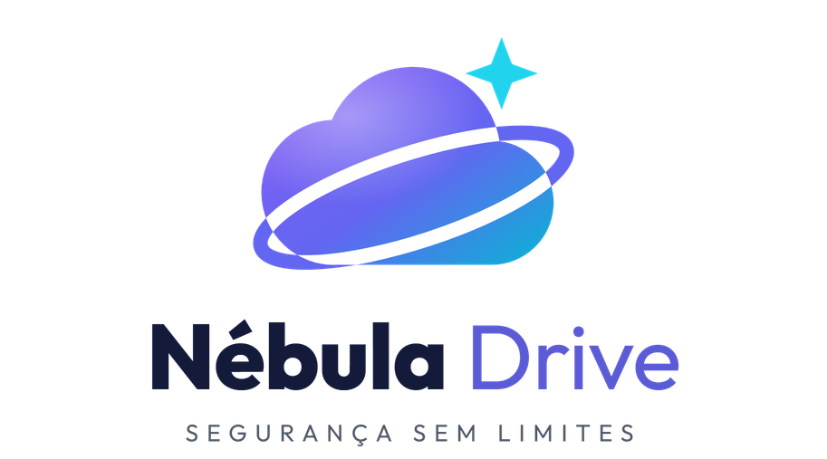

## 💎 Nébula Drive

### **Your cloud, your cinema, your library and your office — all in one place**

[⬅️ Back to README](../README-en.md) · [🇧🇷 Português](NEBULA-DRIVE.md)

---

**Nébula Drive** is the full edition of NebulaFTP. It replaces, all at once:

| Instead of... | You get in Nébula Drive |
|---|---|
| ☁️ Google Drive / Dropbox | **My Drive** — your personal cloud with unlimited space |
| 🎬 Netflix / Prime Video | **Libraries** of movies, series, dramas and lessons |
| 📚 Kindle / Audible | A **book reader** that reads aloud |
| 🎵 Spotify | A **music player** organized by artist and album |
| 📝 Office 365 / Google Docs | **Online Office** for Word, Excel and PowerPoint |

---

## 📑 Contents

1. [Your personal cloud (My Drive)](#-1-your-personal-cloud-my-drive)
2. [Home cinema: movies and series](#-2-home-cinema-movies-and-series)
3. [Mini dramas](#-3-mini-dramas)
4. [Books, comics and audiobooks](#-4-books-comics-and-audiobooks)
5. [Music and video lessons](#-5-music-and-video-lessons)
6. [Online Office](#-6-online-office)
7. [Share with family, friends and clients](#-7-share-with-family-friends-and-clients)
8. [Bring everything from Google Drive](#-8-bring-everything-from-google-drive)
9. [Artificial Intelligence assistant](#-9-artificial-intelligence-assistant)
10. [Watch on TV and use it as a drive](#-10-watch-on-tv-and-use-it-as-a-drive)
11. [App, dark theme and languages](#-11-app-dark-theme-and-languages)
12. [Admin panel](#-12-admin-panel)
13. [Community × Nébula Drive](#-community--nébula-drive)

---

## ☁️ 1. Your personal cloud (My Drive)

Everything you expect from a modern cloud, with room to spare:

- 📤 **Upload files and whole folders** just by dragging them onto the screen. Folders with hundreds of subfolders are recreated exactly as they were.
- 📊 **Track your uploads** in a small panel showing each file's progress. If your connection drops, it retries on its own without losing what was already sent.
- 🔁 **Duplicate file?** Nébula asks: **replace**, **keep both** or **skip** — and you can apply the answer to all.
- 🕰️ **Version history:** replaced a document by mistake? Go back to a previous version with one click.
- ⭐ **Starred, Recent and Trash:** your favorites at hand, what you opened last and a trash bin to recover what you deleted by accident.
- 🖱️ **Just like you're used to:** list or grid, right-click menu, drag to move, keyboard shortcuts and quick search.

---

## 🎬 2. Home cinema: movies and series

Your video folders become a streaming platform:

- 🖼️ **Automatic catalog:** Nébula recognizes the movie or series and fetches the **poster**, **backdrop**, **synopsis**, **year**, **genres** and **rating** by itself.
- 📺 **Series by season and episode**, with each episode's picture and summary and what you've already watched.
- ▶️ **Instant play**, even for big movies, and you can jump to any point without stuttering.
- ⏯️ **Continue watching:** stopped on your phone? Continue on the TV or computer, from the exact second you left. When an episode ends, it suggests the next one.
- 🗂️ **Separate libraries:** Dubbed Movies, Subtitled Movies, Dubbed Series, Subtitled Series and more.

---

## 📱 3. Mini dramas

- A showcase just for **short dramas, K-dramas and vertical series**.
- **Quick filters** by language and theme (Dubbed, Subtitled, Brazilian, CEO, Revenge, Romance...).
- **Episode after episode**, without going back to the menu.

---

## 📚 4. Books, comics and audiobooks

- 📖 **Opens everything in the browser:** e-books (EPUB, MOBI, Kindle, PDF, FB2, TXT) and comics and manga (CBZ, CBR), with nothing to install.
- 🎧 **Turns into an audiobook with one click:** natural voices read the book to you. The sentence being read is highlighted and **the page turns by itself**.
- ⏩ **Reading speed** from 0.75× to 2×, and you can go back or skip ahead.
- 🌙 **Comfortable reading:** light, dark or sepia theme, and the font size you like.
- 🖍️ **Study inside the book:** table of contents, text search, colored highlights with notes and bookmarks.
- 🔖 **Continue reading:** open the book on any device and return to the exact page where you stopped.

---

## 🎵 5. Music and video lessons

- 🎶 **Music organized automatically** by **Artist → Album → Track**, with an on-screen player that plays the whole album.
- 🎓 **Video lessons and family videos** organized by folder and date, saving your progress in each lesson.

---

## 📝 6. Online Office

- ➕ **Create from the "+ New" button** a blank document, spreadsheet or presentation.
- ✏️ **Edit in the browser** Word, Excel and PowerPoint files, with full formatting — no Office installed.
- 💾 **Saves automatically** as you type.

---

## 🔗 7. Share with family, friends and clients

- 👥 **Share with people or groups** (Family, Clients, Students...). Anyone without an account gets an invite.
- 🔐 **You choose what each person can do:**
  1. **Only watch or read** online, without downloading;
  2. **View and download**;
  3. **Upload files** to the folder;
  4. **Edit and organize** everything.
- ⏳ **Time-limited access:** grant access for 7 or 30 days and it ends on its own.
- 🌍 **Public links** to send over WhatsApp or e-mail, with a **password** and an **expiry date**.

---

## 📥 8. Bring everything from Google Drive

- 🔌 **Connect one or more** Google Drive accounts, paste the folder link and click **Import**.
- 🚀 **The server copies everything by itself**, without using your internet — you can even turn off your computer.
- 📈 See how many files and gigabytes have been copied, with the option to pause or cancel.
- 🔓 **Password-protected folders** (rclone crypt) are imported too.

---

## ✨ 9. Artificial Intelligence assistant

- 🔎 **Find files by chatting:** *"Where is last month's report?"*
- 📄 **Summarize documents** open on screen.
- 🗂️ **Organize your Drive:** the AI suggests folders, and nothing is created until you confirm.

---

## 📺 10. Watch on TV and use it as a drive

- 📺 **Smart TV, TV box, phone and Kodi:** works with the **Jellyfin** apps — your libraries show up with covers and where you left off.
- 💽 **Drive on your computer:** connect Nébula Drive as a drive on Windows, Mac or Linux, without using your hard disk.

---

## 📲 11. App, dark theme and languages

- 📲 **Install it as an app** on Windows, Mac, Android and iPhone, no app store needed.
- 🌗 **Light or dark theme**, following your device.
- 🌐 **Portuguese and English.**

---

## 🛠️ 12. Admin panel

For whoever runs the system:

- 📊 **Overview:** users online, space used and who is watching right now.
- 👤 **Users:** invites, roles (Administrator, User or Guest), storage quota, simultaneous screens and expiry date.
- 👥 **Groups:** grant or remove access for many people at once.
- 🎞️ **Libraries:** choose the folders, fetch covers and fix a title with one click.
- 📜 **Audit log:** who logged in, uploaded, moved, shared or deleted each file.
- 🛡️ **Automatic backups** of the channels and **several bots** for more speed.
- 🗄️ Optional **MongoDB database** for large installs.

---

## ⚖️ Community × Nébula Drive

| | 🆓 Community | 💎 Nébula Drive |
|---|:---:|:---:|
| Unlimited space on Telegram | ✅ | ✅ |
| Access as a drive on your computer | ✅ | ✅ |
| Multiple users, each with their own folder | ✅ | ✅ + groups, quotas and expiry |
| Video and music in the browser | ✅ basic | ✅ Netflix-style |
| Upload speed | 1 bot | ⚡ several bots |
| Google Drive-style sharing | ❌ | ✅ |
| Libraries with covers and seasons | ❌ | ✅ |
| Book reader with voice | ❌ | ✅ |
| Online Office | ❌ | ✅ |
| Import from Google Drive | ❌ | ✅ |
| Version history and trash | ❌ | ✅ |
| AI assistant | ❌ | ✅ |
| Smart TV (Jellyfin, Kodi) | ❌ | ✅ |
| Automatic backup | ❌ | ✅ |
| MongoDB database | ❌ | ✅ |
| Support | Community | Priority |

---

### 📩 Want Nébula Drive?

**samuel@inglescurso.com.br**

[⬅️ Back to README](../README-en.md)

