

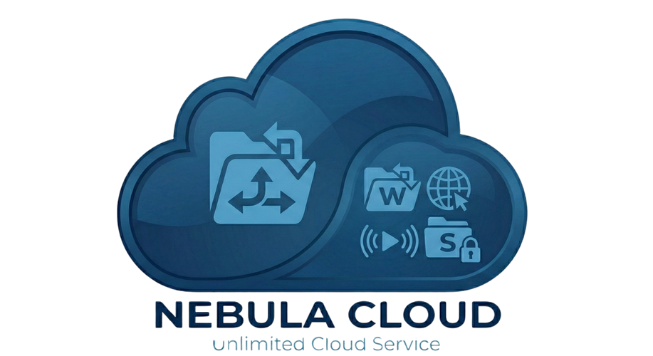

## 💎 Nébula Drive

### **Sua nuvem, seu cinema, sua biblioteca e seu escritório — tudo em um só lugar**

[⬅️ Voltar ao README](../README.md) · [🇺🇸 English](NEBULA-DRIVE-en.md)

---

O **Nébula Drive** é a edição completa do NebulaFTP. Ele substitui, ao mesmo tempo:

| Em vez de... | Você tem no Nébula Drive |
|---|---|
| ☁️ Google Drive / Dropbox | **Meu Drive** — sua nuvem pessoal com espaço ilimitado |
| 🎬 Netflix / Prime Video | **Bibliotecas** de filmes, séries, novelas e aulas |
| 📚 Kindle / Audible | **Leitor de livros** que lê em voz alta |
| 🎵 Spotify | **Player de músicas** organizado por artista e álbum |
| 📝 Office 365 / Google Docs | **Office online** para Word, Excel e PowerPoint |

---

## 📑 Sumário

1. [Sua nuvem pessoal (Meu Drive)](#-1-sua-nuvem-pessoal-meu-drive)
2. [Cinema em casa: filmes e séries](#-2-cinema-em-casa-filmes-e-séries)
3. [Mini novelas](#-3-mini-novelas)
4. [Livros, quadrinhos e audiolivro](#-4-livros-quadrinhos-e-audiolivro)
5. [Músicas e vídeo aulas](#-5-músicas-e-vídeo-aulas)
6. [Office online](#-6-office-online)
7. [Compartilhar com família, amigos e clientes](#-7-compartilhar-com-família-amigos-e-clientes)
8. [Trazer tudo do Google Drive](#-8-trazer-tudo-do-google-drive)
9. [Assistente de Inteligência Artificial](#-9-assistente-de-inteligência-artificial)
10. [Assistir na TV e usar como disco](#-10-assistir-na-tv-e-usar-como-disco)
11. [App, tema escuro e idiomas](#-11-app-tema-escuro-e-idiomas)
12. [Painel do administrador](#-12-painel-do-administrador)
13. [Community × Nébula Drive](#-community--nébula-drive)

---

## ☁️ 1. Sua nuvem pessoal (Meu Drive)

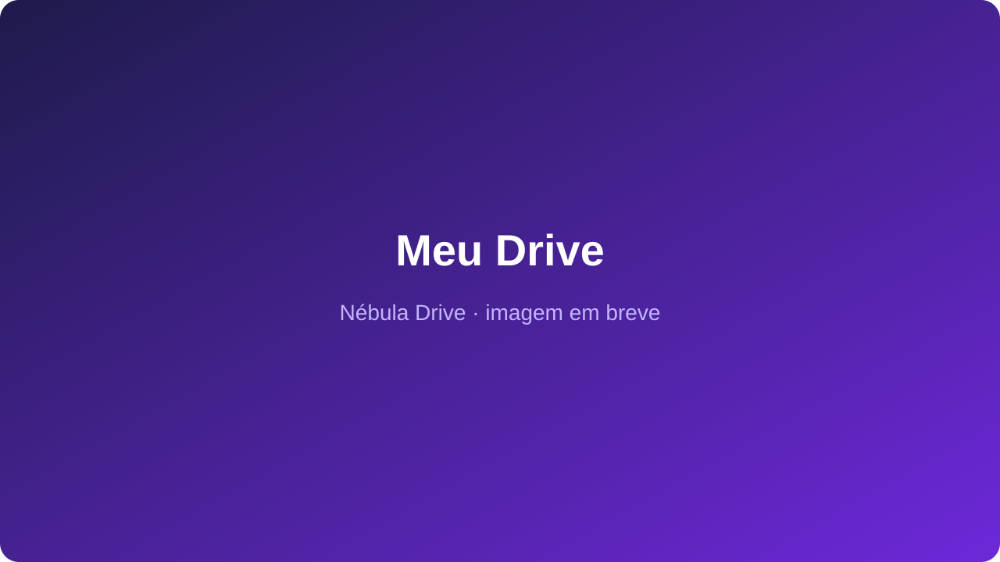

Tudo o que você espera de uma nuvem moderna, com espaço de sobra:

- 📤 **Envie arquivos e pastas inteiras** só arrastando para a tela. Pastas com centenas de subpastas são recriadas do jeito que estavam.
- 📊 **Acompanhe os envios** numa janelinha com o progresso de cada arquivo. Se a internet cair, ele tenta de novo sozinho, sem perder o que já foi.
- 🔁 **Arquivo repetido?** O Nébula pergunta: **substituir**, **manter os dois** ou **pular** — e você pode aplicar a resposta a todos.
- 🕰️ **Histórico de versões:** substituiu um documento por engano? Volte para uma versão anterior com um clique.
- ⭐ **Com estrela, Recentes e Lixeira:** seus favoritos sempre à mão, o que você abriu por último e uma lixeira para recuperar o que apagou sem querer.
- 🖱️ **Do jeito que você já conhece:** lista ou grade, menu com o botão direito, arrastar para mover, atalhos de teclado e busca rápida.

---

## 🎬 2. Cinema em casa: filmes e séries

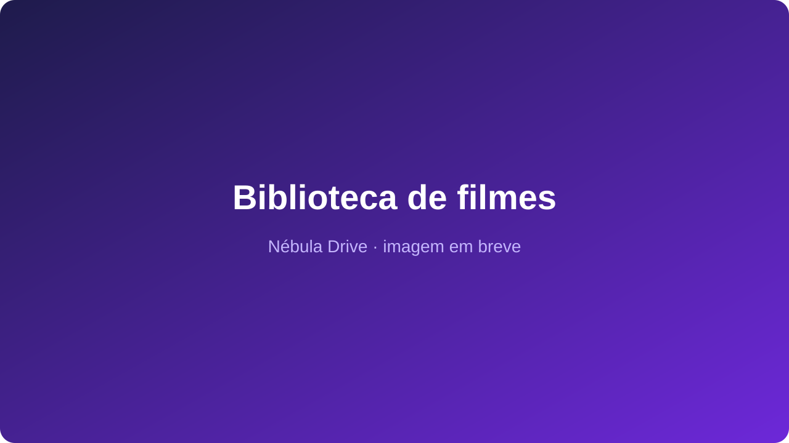

Suas pastas de vídeo viram uma plataforma de streaming:

- 🖼️ **Catálogo automático:** o Nébula reconhece o filme ou a série e busca sozinho o **pôster**, a **imagem de fundo**, a **sinopse em português**, o **ano**, os **gêneros** e a **nota**.
- 📺 **Séries por temporada e episódio**, com a foto e o resumo de cada capítulo e a marcação do que você já viu.
- ▶️ **Play na hora**, mesmo em filmes grandes, e você pode pular para qualquer ponto sem travar.
- ⏯️ **Continuar assistindo:** parou no celular? Continue na TV ou no computador, do segundo exato onde parou. Ao terminar um episódio, ele já sugere o próximo.
- 🗂️ **Bibliotecas separadas:** Filmes Dublados, Filmes Legendados, Séries Dubladas, Séries Legendadas e mais.

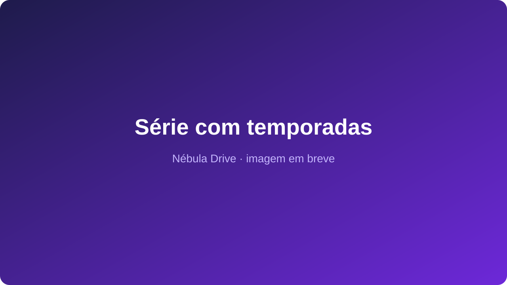

---

## 📱 3. Mini novelas

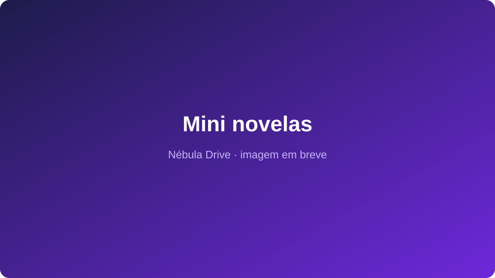

- Uma vitrine só para **novelas curtas, doramas e séries verticais**.
- **Filtros rápidos** por idioma e tema (Dublado, Legendado, Brasileiro, CEO, Vingança, Romance...).
- **Capítulo atrás de capítulo**, sem precisar voltar ao menu.

---

## 📚 4. Livros, quadrinhos e audiolivro

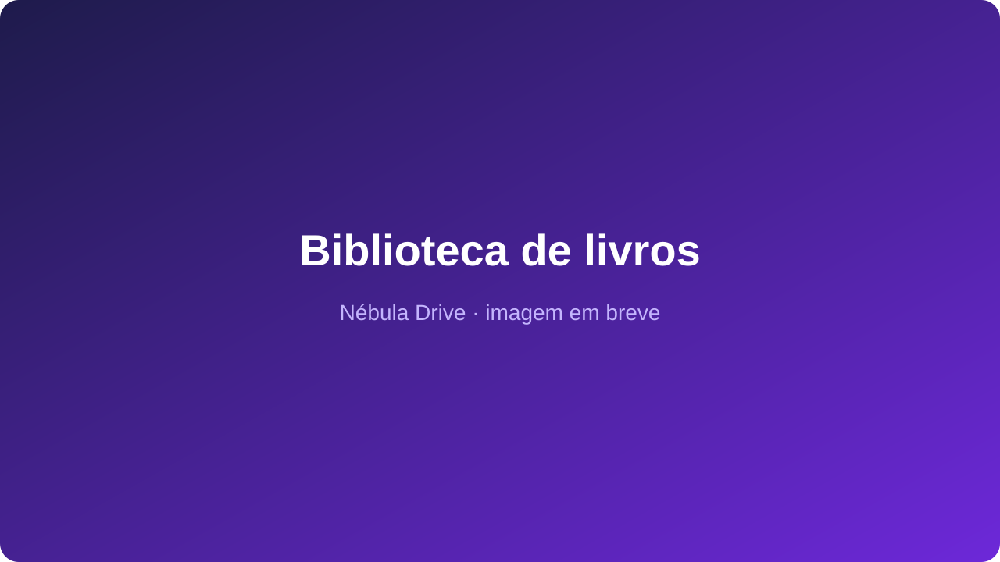

- 📖 **Abre tudo no navegador:** livros digitais (EPUB, MOBI, Kindle, PDF, FB2, TXT) e quadrinhos e mangás (CBZ, CBR), sem instalar nada.
- 🎧 **Vira audiolivro com um clique:** vozes naturais em português (Thalita, Francisca, Antonio) leem o livro para você. A frase lida fica destacada e **a página vira sozinha**.
- ⏩ **Velocidade da leitura** de 0,75× a 2×, e você pode voltar ou avançar trechos.
- 🌙 **Leitura confortável:** tema claro, escuro ou sépia, e tamanho da letra do seu jeito.
- 🖍️ **Estude dentro do livro:** sumário, busca no texto, grifos coloridos com anotações e marcadores.
- 🔖 **Continuar lendo:** abra o livro em qualquer aparelho e volte para a página exata onde parou.

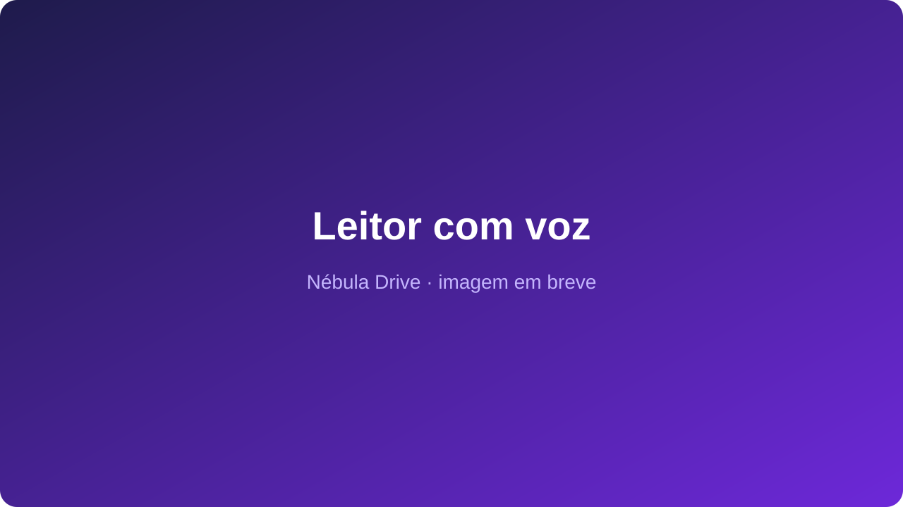

---

## 🎵 5. Músicas e vídeo aulas

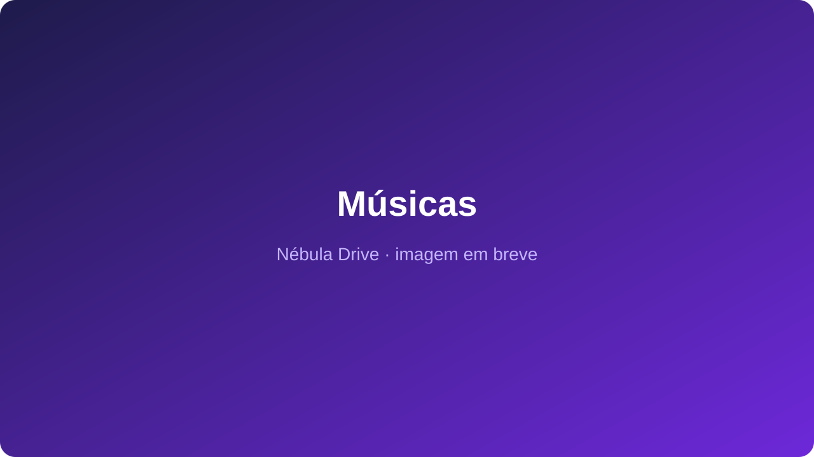

- 🎶 **Músicas organizadas sozinhas** por **Artista → Álbum → Faixa**, com player na própria tela que toca o álbum inteiro.
- 🎓 **Vídeo aulas e vídeos de família** organizados por pasta e por data, guardando o seu progresso em cada aula.

---

## 📝 6. Office online

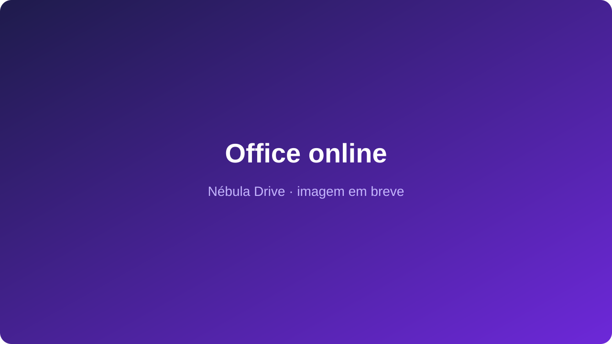

- ➕ **Crie pelo botão "+ Novo"** um documento, uma planilha ou uma apresentação em branco.
- ✏️ **Edite no navegador** arquivos do Word, Excel e PowerPoint, com formatação completa — sem ter o Office instalado.
- 💾 **Salva sozinho** enquanto você digita.

---

## 🔗 7. Compartilhar com família, amigos e clientes

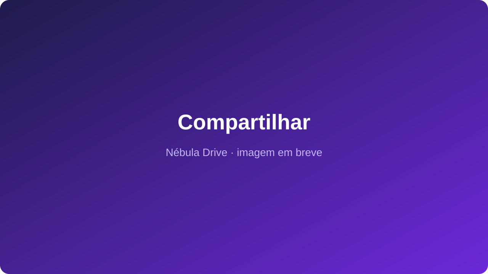

- 👥 **Compartilhe com pessoas ou grupos** (Família, Clientes, Alunos...). Quem não tem conta recebe um convite.
- 🔐 **Você escolhe o que cada um pode fazer:**
  1. **Só assistir ou ler** online, sem baixar;
  2. **Ver e baixar**;
  3. **Enviar arquivos** para a pasta;
  4. **Editar e organizar** tudo.
- ⏳ **Acesso com prazo:** libere por 7 ou 30 dias, e o acesso termina sozinho.
- 🌍 **Links públicos** para mandar no WhatsApp ou e-mail, com **senha** e **data de validade**.

---

## 📥 8. Trazer tudo do Google Drive

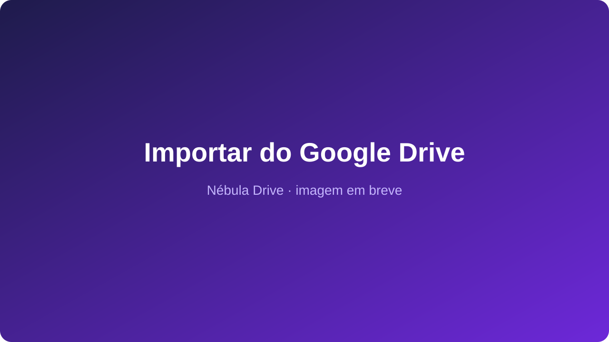

- 🔌 **Conecte uma ou várias contas** do Google Drive, cole o link da pasta e clique em **Importar**.
- 🚀 **O servidor copia sozinho**, sem usar a sua internet — pode até desligar o computador.
- 📈 Acompanhe quantos arquivos e gigabytes já foram copiados, com opção de pausar ou cancelar.
- 🔓 **Pastas protegidas com senha** (rclone crypt) também são importadas.

---

## ✨ 9. Assistente de Inteligência Artificial

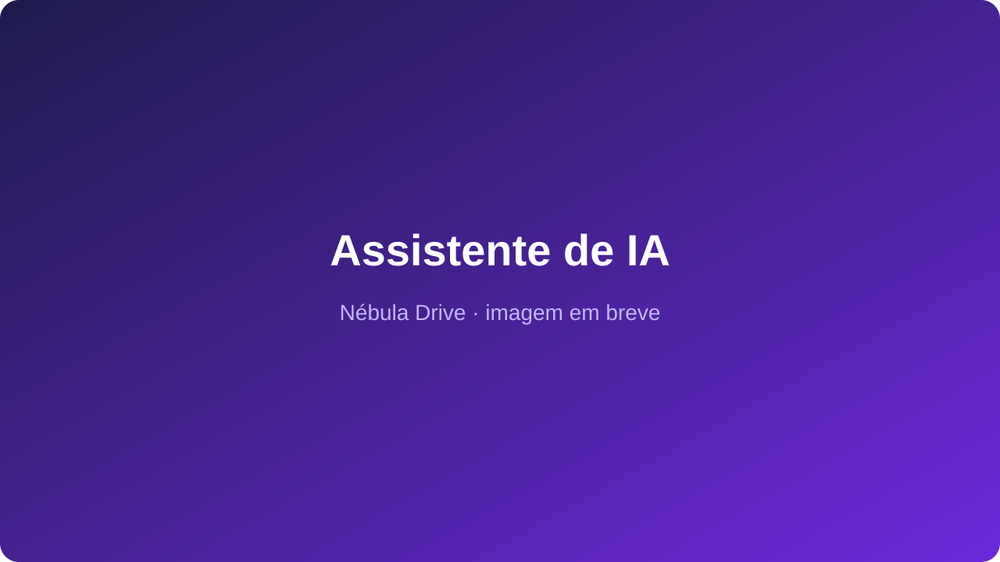

- 🔎 **Encontre arquivos conversando:** *"Onde está o relatório do mês passado?"*
- 📄 **Resuma documentos** abertos na tela.
- 🗂️ **Organize o Drive:** a IA sugere pastas, e nada é criado sem você confirmar.

---

## 📺 10. Assistir na TV e usar como disco

- 📺 **Smart TV, TV Box, celular e Kodi:** compatível com os apps do **Jellyfin** — suas bibliotecas aparecem com capas e o ponto onde você parou.
- 💽 **Disco no computador:** conecte o Nébula Drive como uma unidade no Windows, no Mac ou no Linux, sem ocupar espaço no seu HD.

---

## 📲 11. App, tema escuro e idiomas

- 📲 **Instale como aplicativo** no Windows, Mac, Android e iPhone, sem passar pela loja.
- 🌗 **Tema claro ou escuro**, seguindo o seu aparelho.
- 🌐 **Português e inglês.**

---

## 🛠️ 12. Painel do administrador

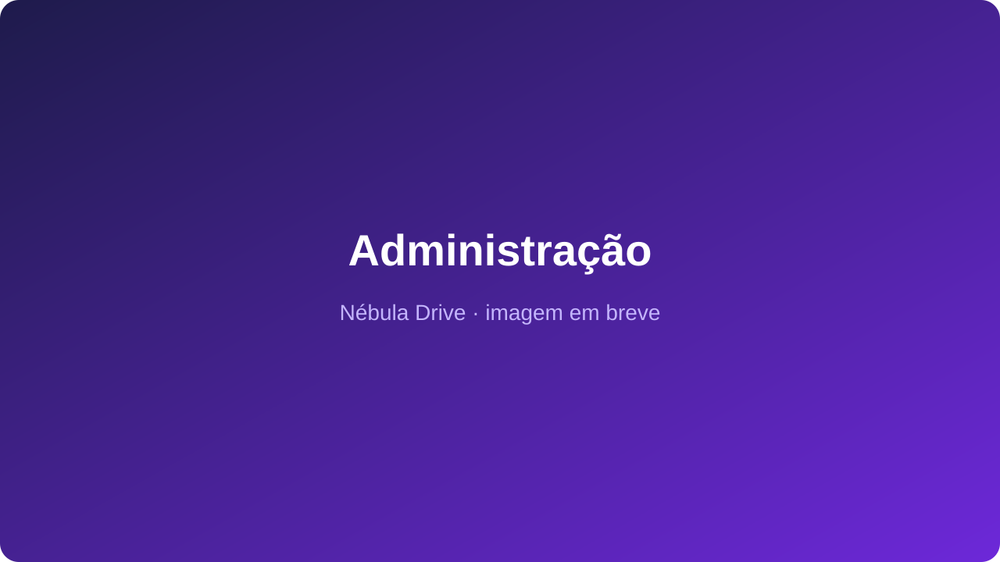

Para quem cuida do sistema:

- 📊 **Visão geral:** usuários online, espaço usado e quem está assistindo agora.
- 👤 **Usuários:** convites, papéis (Administrador, Usuário ou Convidado), cota de espaço, número de telas ao mesmo tempo e data de expiração.
- 👥 **Grupos:** libere ou remova acesso de muitas pessoas de uma vez.
- 🎞️ **Bibliotecas:** escolha as pastas, busque as capas e corrija um título com um clique.
- 📜 **Auditoria:** quem entrou, enviou, moveu, compartilhou ou apagou cada arquivo.
- 🛡️ **Cópias de segurança automáticas** dos canais e **vários robôs** para mais velocidade.
- 🗄️ **Banco MongoDB** opcional, para instalações grandes.

---

## ⚖️ Community × Nébula Drive

| | 🆓 Community | 💎 Nébula Drive |
|---|:---:|:---:|
| Espaço ilimitado no Telegram | ✅ | ✅ |
| Acesso como disco no computador | ✅ | ✅ |
| Vários usuários, cada um com sua pasta | ✅ | ✅ + grupos, cotas e prazo |
| Vídeo e música no navegador | ✅ básico | ✅ estilo Netflix |
| Velocidade de envio | 1 robô | ⚡ vários robôs |
| Compartilhamento estilo Google Drive | ❌ | ✅ |
| Bibliotecas com capas e temporadas | ❌ | ✅ |
| Leitor de livros com voz | ❌ | ✅ |
| Office online | ❌ | ✅ |
| Importar do Google Drive | ❌ | ✅ |
| Histórico de versões e lixeira | ❌ | ✅ |
| Assistente de IA | ❌ | ✅ |
| Smart TV (Jellyfin, Kodi) | ❌ | ✅ |
| Cópia de segurança automática | ❌ | ✅ |
| Banco MongoDB | ❌ | ✅ |
| Suporte | Comunidade | Prioritário |

---

### 📩 Quer o Nébula Drive?

**samuel@inglescurso.com.br**

[⬅️ Voltar ao README](../README.md)

